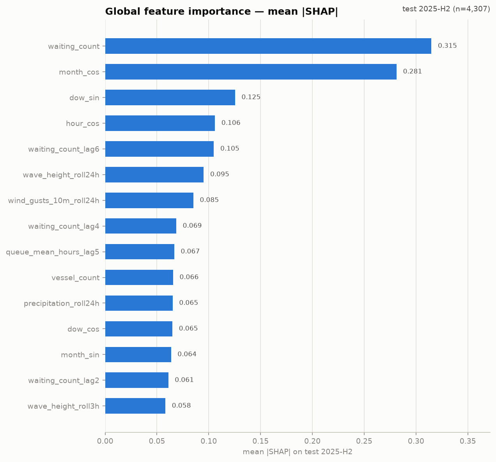
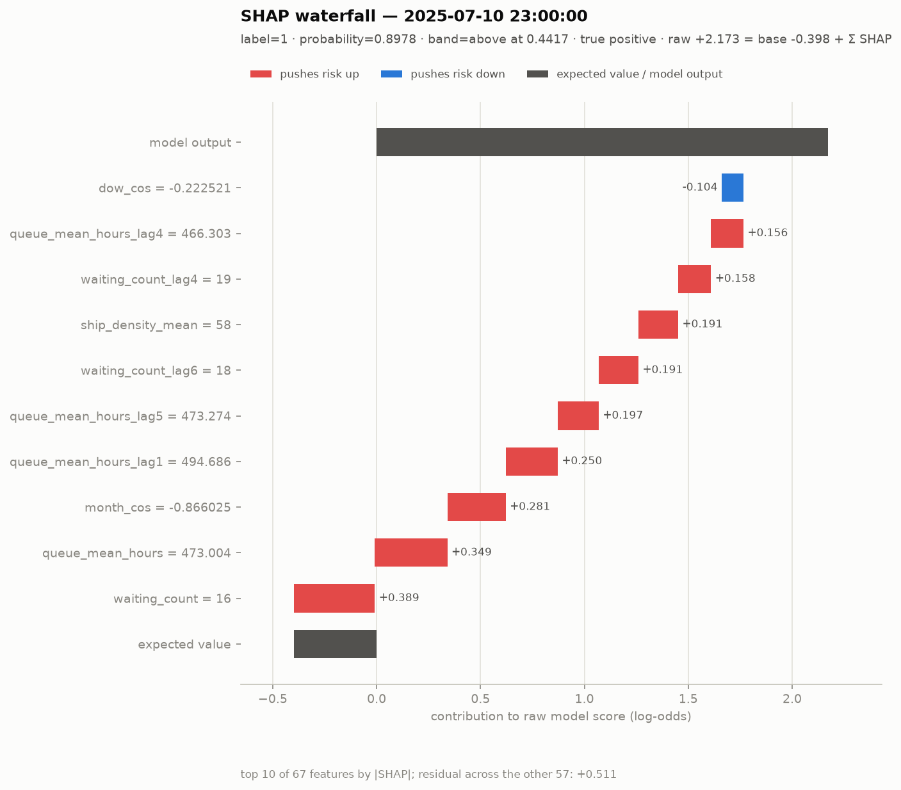
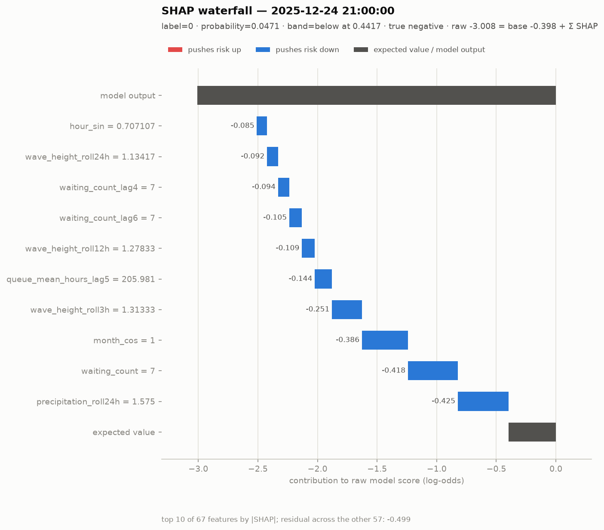
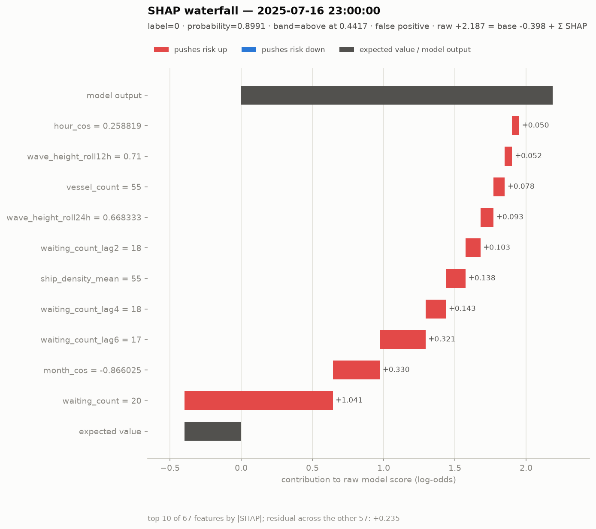
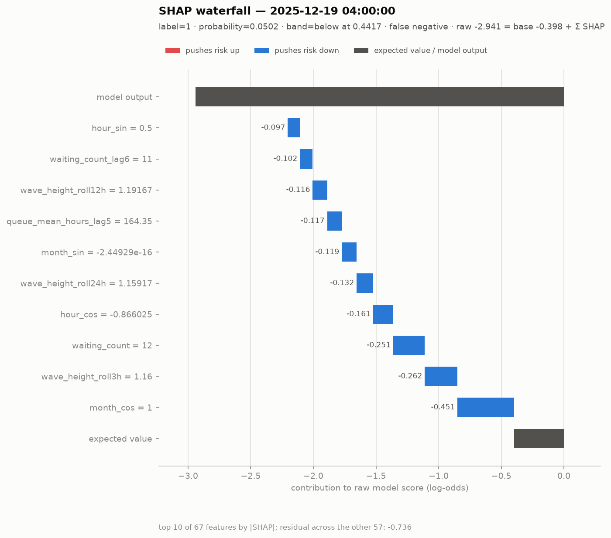

# SHAP explanations & failure analysis

Generated by `.venv/bin/python -m src.explain --report` from
`models/lightgbm.txt` (constrained LightGBM booster, 67 features).
Figures live in `reports/figures/`.

## Method (binding rules)

- **SHAP explains the booster's raw output.** `shap.TreeExplainer` is fit on
  the booster alone; the row probability is
  `sigmoid(expected_value + Σ SHAP)`, which matches `booster.predict` to
  better than 1e-9 (test-pinned). The isotonic calibrator is applied after
  the raw prediction for the CLI's event-probability output; it is never fed
  to SHAP.
- **Raw-model error-analysis threshold:** `above` iff raw probability >= **0.4417**, the
  F1-maximizing threshold selected on val 2025-H1 only
  (`threshold_selection.per_model.lightgbm_raw` in
  `reports/metrics_final.json`), applied unchanged to test 2025-H2.
- **High-confidence misclassification rule (exact):** a test hour qualifies
  iff **(1)** it sits on the wrong side of that threshold —
  `(p >= thr) != label` — **and (2)** its confidence in the wrongly predicted
  class is >= thr: for a false positive `p >= thr`, for a false negative
  `1 - p >= thr`. At thr = 0.4417 < 0.5, leg (2) is implied by leg (1)
  (FP by definition; FN because `1 - p > 1 - thr > thr`), so the pool is
  exactly the **1,246** misclassified test hours
  (1,039 FP + 207 FN of 4,307; test base rate 13.49%). Case
  studies below are the most confident error of each type: highest
  **confidence in the wrongly predicted class**, ties broken by earliest
  `hour_key`.

## Global drivers — test 2025-H2 (n=4,307)



Top 10 by mean |SHAP| (table twin of the figure):

| # | feature | mean \|SHAP\| |
|---|---------|--------------|
| 1 | `waiting_count` | 0.3149 |
| 2 | `month_cos` | 0.2812 |
| 3 | `dow_sin` | 0.1253 |
| 4 | `hour_cos` | 0.1059 |
| 5 | `waiting_count_lag6` | 0.1049 |
| 6 | `wave_height_roll24h` | 0.0951 |
| 7 | `wind_gusts_10m_roll24h` | 0.0851 |
| 8 | `waiting_count_lag4` | 0.0686 |
| 9 | `queue_mean_hours_lag5` | 0.0667 |
| 10 | `vessel_count` | 0.0655 |

## Genuinely congested, model right — 2025-07-10 23:00:00

Observed label **1**, probability **0.8978** → band `above`
at 0.4417 → **true positive**. Top drivers: `waiting_count` +0.389, `queue_mean_hours` +0.349, `month_cos` +0.281.



Every large push points the same way: `waiting_count` = 16 contributes
+0.389 and `queue_mean_hours` = 473.004 adds +0.349, with the seasonal
term `month_cos` (+0.281) reinforcing the July peak. Nothing among the
top drivers argues down, so the booster clears the threshold with margin
(p = 0.8978). This is the model working as designed —
queue level and seasonal context agreeing.

## Genuinely clear, model right — 2025-12-24 21:00:00

Observed label **0**, probability **0.0471** → band `below`
at 0.4417 → **true negative**. Top drivers: `precipitation_roll24h` -0.425, `waiting_count` -0.418, `month_cos` -0.386.



All three largest pushes are downward: `precipitation_roll24h` (-0.425),
`waiting_count` = 7 (-0.418), `month_cos` (-0.386). The
December seasonal term alone removes 0.386 from the raw score and
a light queue keeps it there; the hour never approaches 0.4417
(p = 0.0471).

## Failure analysis — high-confidence wrong

Pool: **1,246** hours (1,039 FP + 207 FN of 4,307) under the
rule above. The two case studies are the most confident error of each type.

### False positive — 2025-07-16 23:00:00 (p = 0.8991, label = 0)



**Post-mortem:** The top three pushes are `waiting_count` = 20 (+1.041),
`month_cos` = -0.866025 (+0.330), `waiting_count_lag6` = 17 (+0.321) — all
upward: queue level plus its lag and the July seasonal term — so the
booster lands at p = 0.8991, far above 0.4417. The label
says no
congestion materialised by t+6: the queue drained inside the horizon (or
the delay component never confirmed), a transition that queue *level*
cannot express. Monotone constraints only allow queue features to push
risk upward, so nothing in this row can call the drain.
**Operational hook:** escalate on queue level only when the 6-hour queue
trend is flat-to-rising; a queue-derivative/throughput feature would let
the booster discount a falling queue.

### False negative — 2025-12-19 04:00:00 (p = 0.0502, label = 1)



**Post-mortem:** The seasonal prior dominates: `month_cos` = 1 removes
0.451 from the raw score; calm `wave_height_roll3h` = 1.16 (-0.262)
adds to the suppression, and a moderate queue (`waiting_count` = 12,
-0.251) never fights back — the booster lands at p = 0.0502,
far below 0.4417, while the label says congestion did occur. It is not
an isolated miss: 63
of the 207 test FNs fall in December 2025 (clustered on days 4–19).
**Operational hook:** compare queue level against its seasonal baseline (or
use a season-aware threshold) before dismissing a winter episode; queue
acceleration should be able to override a calm-weather prior.

## CLI

```bash
.venv/bin/python -m src.explain --hour 2025-07-15T14:00
```

prints both the raw LightGBM probability and the isotonic-calibrated
congestion probability, followed by a decision flag based on the calibrated
model's validation-selected threshold (0.3333). SHAP drivers continue to
explain the raw model output. The false-positive / false-negative analysis
above deliberately uses the separate raw-model threshold (0.4417) so the
reported error counts remain consistent with the evaluation table.
