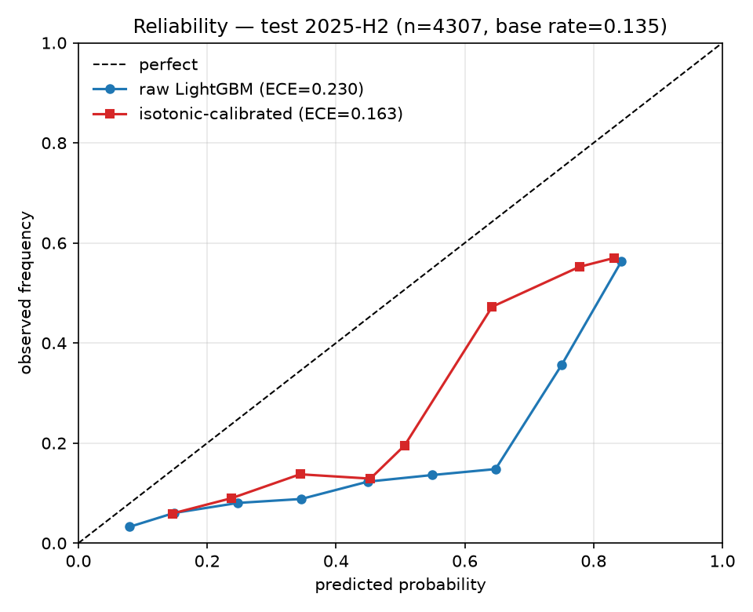
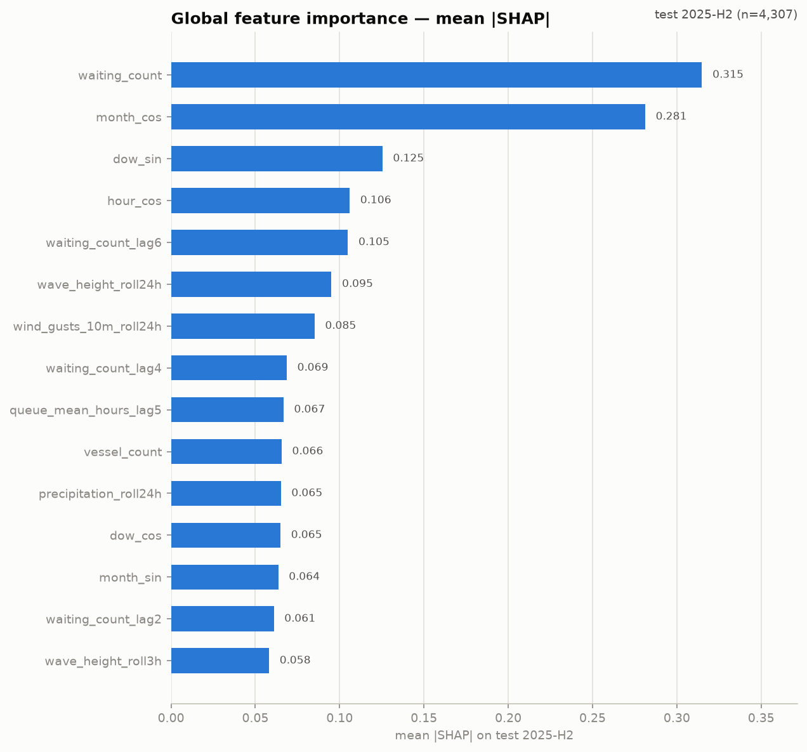

# Port Congestion & Shipment Delay Forecast

*A six-hour-ahead prediction system for the Los Angeles / Long Beach port region*  
*Aiqon AI Internship Take-Home | 15 November 2026*

## 1. Executive summary

This project estimates whether port congestion is likely to occur six hours ahead. At each hour *t*, the model uses information available up to that point to estimate the probability that the port will be congested at *t+6*. The aim is to give operations teams an earlier warning, along with an indication of the factors behind the forecast.

The final dataset contains 22,378 port-hour records and 67 engineered features. We compared persistence and logistic-regression baselines with a LightGBM model. On the held-out second half of 2025, LightGBM achieved the strongest ROC-AUC (0.747) and PR-AUC (0.386). Isotonic calibration improved its Brier score from 0.170 to 0.132, although calibration remained imperfect. Persistence produced a higher F1 score, so the results do not show that LightGBM is best on every metric.

## 2. Defining congestion

Congestion is not captured by a single measurement. We combined three operational signals into a port-hour index: the number of vessels waiting, the median vessel delay, and average queue hours. Each signal is scaled against a baseline calculated from pre-2025 data, capped to limit the effect of extreme values, and then weighted.

> **Congestion index** = 0.4 × waiting severity + 0.4 × delay severity + 0.2 × queue severity

An hour is labelled congested when its index reaches the 75th percentile of the pre-2025 index distribution (0.01698). The initial fixed thresholds of 0.55–0.70 produced no positive labels because the observed index never reached those values. We therefore used the training-period percentile instead. This produced a positive rate of about 25% in the pre-2025 period and kept the modelling dataset within the assignment's requested 20–35% range.

## 3. Data and features

The source is the public Kaggle dataset `nguyenductuandat/lalb-ais-port-congestion-62023-122025`, released under CC BY 4.0. It contains 21.68 million AIS rows across 53 columns. The source data had already been preprocessed by its publisher; this project performs the hourly aggregation, label construction, feature engineering, modelling and evaluation. The resulting modelling table covers June 2023 to December 2025. The six-hour target is created by looking six hours forward, and records without an observable target because of data gaps or the end of the series are excluded.

The 67 features are grouped into five practical categories: current and lagged vessel/queue conditions; port-state history; time-of-day, day-of-week and seasonal encodings; weather and past-only weather summaries; and traffic-flow measures such as arrivals and rolling counts. Missingness indicators are also included so the model can distinguish a measured value from an imputed one.

**Scope:** this is a port-level congestion forecast for the LA/LB region. It is not yet an individual shipment ETA or shipment-specific delay predictor, and performance at other ports has not been tested.

## 4. Modelling and evaluation

We trained three approaches: a persistence baseline (current congestion carried forward six hours), class-balanced logistic regression, and LightGBM. LightGBM was selected as the main model because it can capture non-linear relationships between traffic, weather and time-related features. Monotonic constraints were applied to queue, waiting and density features so that increasing these pressure signals cannot, by themselves, reduce the model's predicted risk.

To reflect how the system would be used, the data was split chronologically rather than randomly. The model was trained on June 2023–December 2024, validated on January–June 2025, and tested once on July–December 2025. A six-hour purge was applied at split boundaries to prevent target information from crossing between periods. Hyperparameter tuning was confined to the training period.

| Period | Records | Congested share |
|---|---:|---:|
| Training: Jun 2023–Dec 2024 | 13,750 | 24.98% |
| Validation: Jan–Jun 2025 | 4,315 | 43.64% |
| Test: Jul–Dec 2025 | 4,307 | 13.49% |

The large change in positive rate between validation and test is important. It means the model is being tested under a different operating pattern, and metrics such as PR-AUC should be compared within a split rather than directly across periods.

**Held-out test results (July–December 2025)**

| Model | ROC-AUC | PR-AUC | F1* | Brier | ECE |
|---|---:|---:|---:|---:|---:|
| Persistence | 0.705 | 0.311 | **0.492** | 0.138 | 0.138 |
| Logistic regression | 0.729 | 0.332 | 0.243 | 0.174 | 0.244 |
| LightGBM (raw) | **0.747** | **0.386** | 0.375 | 0.170 | 0.230 |
| LightGBM + isotonic | 0.744 | 0.370 | 0.375 | **0.132** | 0.163 |

*F1 uses a threshold selected on the validation period and applied unchanged to the test period. Brier score and ECE assess probability quality; lower is better.*

The results tell a more balanced story than a single accuracy number. LightGBM ranks congested hours better than the baselines, as shown by its higher ROC-AUC and PR-AUC. Isotonic calibration improves the Brier score, meaning its probabilities are more useful overall than the raw model's. However, persistence has the highest test F1. Its validation-selected threshold was 1.0, which illustrates how a threshold chosen during a high-congestion period can transfer poorly when the congestion rate later falls.

*Figure 1. Reliability on the held-out test period. Isotonic calibration improves the score, but the curve still departs from the ideal diagonal.*

The validation period had a 43.64% positive rate, compared with 13.49% in the test period. The isotonic calibrator was fitted using validation out-of-fold predictions. Its near-zero validation ECE is therefore not treated as evidence of test-time calibration quality. On the test set, calibrated ECE is 0.163: an improvement over the raw model (0.230), but still a limitation.

For individual predictions, the CLI applies the isotonic calibrator before displaying the six-hour congestion probability and its decision flag. SHAP values are still calculated from the raw LightGBM output, so the explanation remains tied to the underlying model.

## 5. Explaining predictions

We used SHAP with the LightGBM model to identify which inputs contributed most to its predictions. On the test period, the strongest global contributors were `waiting_count` (mean |SHAP| 0.315), `month_cos` (0.281) and `dow_sin` (0.125). In practical terms, the model relies on the number of vessels waiting as well as seasonal and weekly patterns. These are associations used by the model, not proof that any one feature causes congestion.

*Figure 2. Global SHAP importance for the held-out test period (mean absolute SHAP value).*

**Example forecast:** at 23:00 on 10 July 2025, the model assigned a congestion probability of 0.90 and the hour was labelled congested. The largest reported contributions were `waiting_count` (+0.389), `queue_mean_hours` (+0.349) and the July seasonal term (+0.281). This gives an operator a short explanation of why the system raised the alert.

## 6. Where the model struggled

At the validation-selected LightGBM threshold of 0.4417, the test set contained 1,039 false positives and 207 false negatives. Two examples help explain the limitations:

- **False positive — 16 July 2025, 23:00 (predicted 0.90, actual clear):** 20 vessels were waiting, which strongly increased the score. The model could not anticipate that the queue would drain before the six-hour target. The monotonic constraints that make the explanation intuitive also limit the model's ability to use other signals to offset a high queue count.
- **False negative — 19 December 2025, 04:00 (predicted 0.05, actual congested):** the seasonal signal associated with December reduced the score despite 12 vessels waiting. 63 of the 207 false negatives occurred between 4 and 19 December. A season-aware threshold or stronger representation of changing seasonal patterns is a reasonable next experiment.

## 7. Operational use, assumptions and next steps

A high forecast can prompt an operations team to review berth plans, pre-position yard crews, confirm tug and pilot availability, and consider wider ETA buffers for carriers. A moderate forecast can trigger more frequent queue monitoring and checks on relief staffing. These are decision-support suggestions, not automatic instructions: an operator should consider live conditions and local constraints before acting.

The report's validation-selected decision thresholds are model-specific: 0.4417 for raw LightGBM and 0.3333 for isotonic-calibrated LightGBM. They should not be mixed or treated as interchangeable risk-band boundaries. The test results also show that probabilities remain optimistic at higher scores, so any operational deployment should monitor calibration and revisit thresholds as seasonal conditions change.

**Key limitations:** the work covers one port region; the AIS source was preprocessed upstream; the congestion label is a constructed index rather than an official port-status label; the delay component of that index uses the visit-level delay snapshot at the target hour; and performance under other ports or future operating regimes is unknown. The next steps would be to validate on another port, test season-aware thresholds, improve the handling of queue drainage, and monitor calibration over time.
